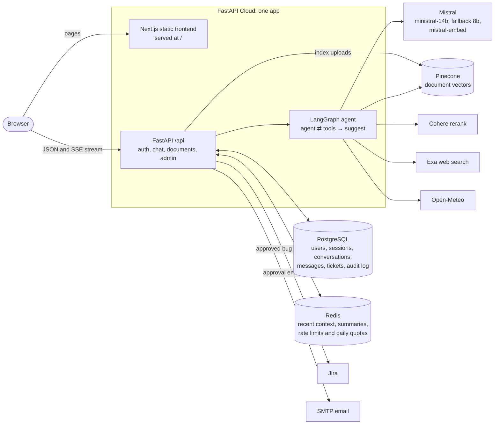

# Chat


A private AI chat app. Users upload PDFs and text files to a conversation and ask
questions about them, or ask anything else; the chat searches their documents or the web
when it needs to and cites each source inline. Replies stream in as they're written. The
same chat also reports live weather and turns bug reports into Jira tickets after an
admin approves them.

One FastAPI app serves both the API (under `/api`) and the built Next.js frontend, and
runs on FastAPI Cloud.

- [Backend](backend/README.md): setup, settings, API, request flow, agent and memory
- [Frontend](frontend/README.md): setup, routes, structure and the chat stream
- [docs/PROGRESS.md](docs/PROGRESS.md): what's done and what's next
- [docs/design/chatbot-v2.md](docs/design/chatbot-v2.md): why things are built this way

## Features

- **Chat with streaming replies** over Server-Sent Events, with saved conversations. A
  new account starts with a conversation ready to type in.
- **Agent with tools:** for each message the model decides whether to answer directly,
  search the user's documents, search the web, check the weather, or file a bug report,
  and can use several tools before answering. A status line shows what it's doing.
- **Document answers (RAG):** uploads are split into chunks, embedded with
  `mistral-embed`, stored in Pinecone and reranked with Cohere.
- **Web search** through Exa, behind a provider interface.
- **Inline citations:** answers cite documents and web pages as numbered badges, such as
  [2], that show the passage or page on hover. Sources are saved with the reply.
- **Suggested questions:** three follow-up questions under the latest reply.
- **Bug reports:** written by the model from the conversation, queued for an admin, then
  created in Jira on approval with an email to the user.
- **Admin dashboard:** bug report approval, an audit log of every API request, server
  error counts, and user and session management, including banning and revoking sessions.
- **Auth:** email and password, short-lived access tokens kept in memory, rotating
  refresh tokens in an HTTP-only cookie, instant revocation, and rate limits on login and
  sign-up.
- **Limits:** 200 chat messages and 30 web searches per user per day, at most 4 tool
  rounds per message, and a cooldown between bug reports.
- **Voice mode** in the browser.
- **One design system** across the landing page, sign-in, chat and admin: dark by
  default with a designed light theme, and smooth scrolling (Lenis) on the landing page.

## Architecture



**A message, in short:** the browser posts to `/api/chat`; the backend checks the
session, the daily limit and the conversation, loads recent context from Redis, and runs
the agent. The reply streams back as typed SSE events (text, tool steps, sources,
suggestions, done), then the turn is saved to Postgres and the trimmed context to Redis.
[backend/README.md](backend/README.md) has the full request flow, the agent graph and
how memory is handled.

## Stack

| Layer | Tools |
|---|---|
| Model | Mistral `ministral-14b`, falling back to `ministral-8b` on rate limits and server errors |
| Retrieval | `mistral-embed`, Pinecone, Cohere rerank; Exa for web search |
| Backend | Python 3.14, FastAPI, LangGraph, SQLAlchemy (async), Alembic, uv |
| Data | PostgreSQL 18 (ids from `uuidv7()`), Redis |
| Frontend | Next.js 16 static export, React, Tailwind CSS v4, shadcn/ui, Lenis, pnpm |
| Hosting | FastAPI Cloud, deployed by GitHub Actions on every push to `main` |

## Run it locally

You need Python 3.14 with [uv](https://docs.astral.sh/uv/), Node.js 24 with pnpm,
PostgreSQL 18, Redis, and API keys for Mistral, Cohere and Pinecone. An Exa key is
optional; without it web search is off. Jira and SMTP are only needed for approving bug
reports.

**Backend** (see [backend/README.md](backend/README.md) for `.env`):

```bash
cd backend/app
uv sync
uv run alembic upgrade head
uv run python seed.py
uv run fastapi dev main.py        # http://localhost:8000
```

**Frontend:**

```bash
cd frontend/Chatbot
pnpm install
pnpm dev                          # http://localhost:3000
```

**Or with Docker Compose**, which starts Postgres and Redis, runs the migrations and the
seed, then the backend:

```bash
docker compose --env-file ./backend/app/.env up -d --build backend
# add the frontend container too:
docker compose --env-file ./backend/app/.env --profile local up -d
```

If Compose fails with "password authentication failed", an old `postgres_data` volume
was created with a different password. Remove it (`docker volume rm
chatbot_postgres_data`) if you don't need its data, or run with another project name
(`-p`).

## Deploy

Pushing to `main` runs `.github/workflows/deploy.yml`, which calls `deploy.sh`. It needs
three repository secrets: `ENV_PRODUCTION` (the whole of `backend/app/.env.production`),
`FASTAPI_CLOUD_TOKEN` and `FASTAPI_CLOUD_APP_ID`.

To deploy by hand, put `FASTAPI_CLOUD_APP_ID=<app id>` in `backend/app/.env.production`
(or export it), then:

```bash
./deploy.sh                          # frontend, database and upload
./deploy.sh --no-db                  # skip migrations and the seed
./deploy.sh --no-frontend --no-db    # backend code only
```

`deploy.sh` builds the frontend into `backend/app/frontend_build`, runs migrations and the
seed against the production database, and uploads the app. The running app reads its
settings from the **FastAPI Cloud dashboard**, not from `.env.production`, so change
settings there too (for example `EXA_API_KEY`, `CHAT_DAILY_LIMIT_PER_USER` or the
`JIRA_*` values).

## Tests and benchmarks

The backend suite has 251 tests (unit, integration, concurrency) against real Postgres
and Redis containers, with 83 % line coverage. [docs/testing.md](docs/testing.md) explains
how to run it.

### Benchmarks: single API instance, single database node

Measured with k6 against one API process (1 CPU, 512 MB) behind nginx, one PostgreSQL 18
node (2 CPU, 1 GB) and one Redis (0.5 CPU), on a seeded dataset of 200 users, 1,000
conversations and 20,000 messages. External services are faked: the chatbot model
streams 40 tokens 20 ms apart (about 0.8 s per reply). Each workload ramps 10 → 25 → 50 →
100 virtual users and holds each level for 90 s. No level of any workload returned an
error.

| Workload | Each iteration | Peak throughput | p95 at 10 VUs | p95 at 100 VUs |
|---|---|---|---|---|
| health | `/health`, `/auth/me` | 137 req/s (50 VUs) | 212 ms | 2.5 s |
| auth | login, `/me`, refresh, logout | 33 req/s (25 VUs) | 831 ms | 7.2 s |
| database-read | list conversations, list messages | 89 req/s (50 VUs) | 309 ms | 3.7 s |
| database-write | create a conversation | 71 req/s (100 VUs) | 307 ms | 4.4 s |
| database-mixed | 80 % reads, 20 % writes | 76 req/s (25 VUs) | 345 ms | 3.9 s |
| conversations | browse with 1–3 s think time | 43 req/s (100 VUs, not saturated) | 28 ms | 1.3 s |
| chatbot | one streamed chat turn | 12.5 turns/s (25 VUs) | 1.4 s | 11.1 s |

At a fixed load of 50 % and 80 % of each peak, held for 3 minutes:

| Workload | Load (50 % / 80 %) | p95 at 50 % | p95 at 80 % | Errors |
|---|---|---|---|---|
| health | 68 / 110 req/s | 78 ms | 1.19 s | 0 |
| auth | 16 / 28 req/s | 69 ms | 159 ms | 0 |
| database-read | 44 / 70 req/s | 626 ms | 655 ms | 0 |
| database-write | 35 / 57 req/s | 116 ms | 995 ms | 0.02 % at 80 % |
| database-mixed | 38 / 61 req/s | 52 ms | 509 ms | 0 |
| conversations | 22 / 34 req/s | 31 ms | 110 ms | 0 |
| chatbot | 6 / 10 turns/s | 940 ms | 1.65 s | 0 |

In every workload except `conversations`, the API container sits at its 1 CPU limit
while Postgres stays under 30 % of its 2 CPUs, so the single API process is the
bottleneck. `auth` is the slowest because each login hashes a password with Argon2id.
k6, the API and the databases share one 8-thread machine, so these numbers compare
setups rather than predict production capacity. Results and analysis are in
[bench/results/phase1/NOTES.md](bench/results/phase1/NOTES.md).

## Project structure

```
backend/app/        FastAPI app: api/, auth/, core/, schemas/, services/, alembic/
frontend/Chatbot/   Next.js app: app/, components/, hooks/, lib/
docs/               Progress and design notes
deploy.sh           Build, migrate and upload to FastAPI Cloud
docker-compose.yml  Local stack only
```
