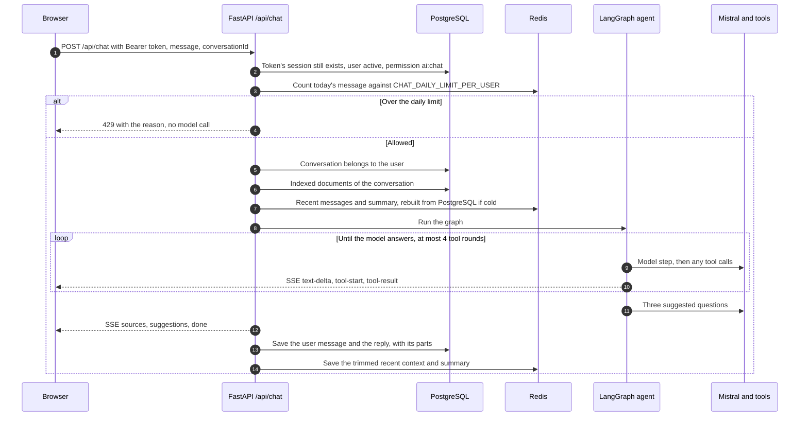
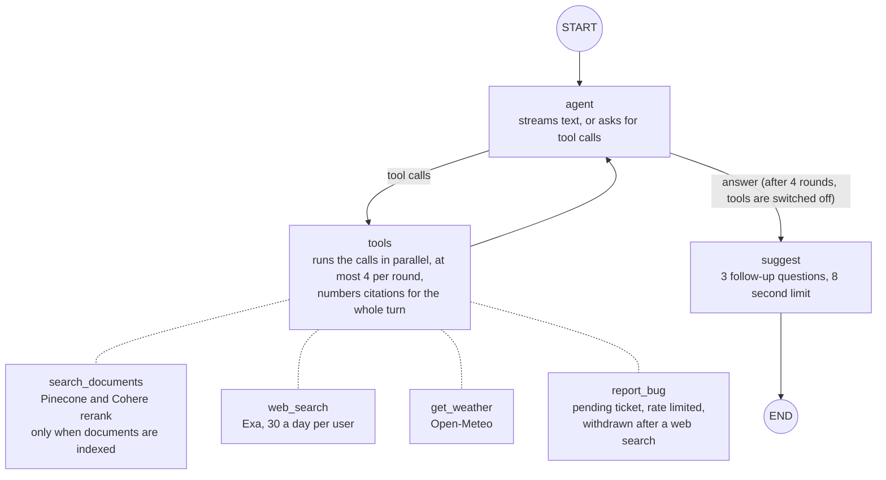
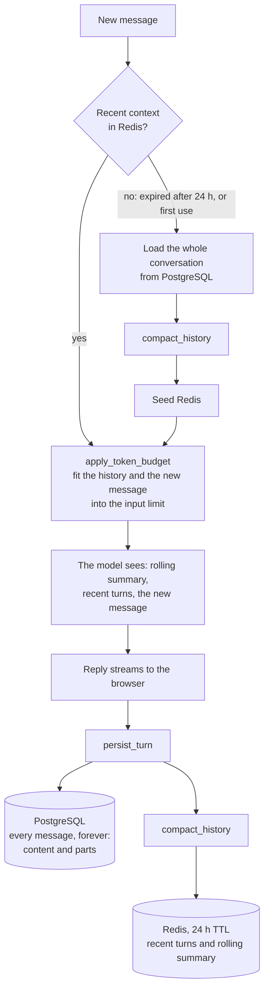

# Chat backend

The FastAPI app. It serves the API under `/api`, the health check at `/health`, and the
built frontend at `/`. The code lives in [`app/`](app/).

## Setup

Requires Python 3.14, [uv](https://docs.astral.sh/uv/), PostgreSQL 18 and Redis.

```bash
cd backend/app
uv sync
# create .env, see below
uv run alembic upgrade head      # create or update tables
uv run python seed.py            # roles, permissions and the admin user; safe to rerun
uv run fastapi dev main.py       # http://localhost:8000, docs at /docs
```

With Docker instead, see the root README; `docker-compose.yml` runs migrate, then seed,
then the backend on each start.

## Settings (`app/.env`)

All settings are in [`core/config.py`](app/core/config.py). In production the app reads
them from the FastAPI Cloud dashboard. These have no default and must be set:

```bash
MISTRAL_API_KEY=
COHERE_API_KEY=
PINECONE_API=
EXA_API_KEY=                      # optional; empty turns web search off
VECTOR_STORE_PROVIDER=pinecone
REDIS_URL=redis://localhost:6379/0
JWT_SECRET_KEY=                   # a long random string

POSTGRESQL_USERNAME=postgres
POSTGRESQL_PASSWORD=
POSTGRESQL_SERVER=localhost
POSTGRESQL_DATABASE=chatbot

ADMIN_EMAIL=                      # created by seed.py
ADMIN_PASSWORD=

JIRA_DOMAIN=                      # your-site.atlassian.net
JIRA_EMAIL=                       # the account that owns the API token
JIRA_API_TOKEN=
JIRA_PROJECT_KEY=                 # the project's key, e.g. SCRUM, not its name
JIRA_ISSUE_TYPE=Task              # must be an issue type the project has
BUG_REPORT_RATE_LIMIT_SECONDS=300
```

Commonly changed optional settings:

| Setting | Default | Notes |
|---|---|---|
| `ENVIRONMENT` | `local` | `local`, `staging` or `production` |
| `CORS_ORIGINS` | `[]` | JSON list, e.g. `["http://localhost:3000"]`. Not needed in production, where the frontend is on the same origin |
| `MISTRAL_MODEL` / `MISTRAL_FALLBACK_MODEL` | `ministral-14b-latest` / `ministral-8b-latest` | Change `MODEL_INPUT_TOKEN_LIMIT` and `MODEL_OUTPUT_TOKEN_LIMIT` with them |
| `PINECONE_INDEX_NAME` | `documents-mistral-embed` | Created on startup if missing, 1024 dimensions. Use a separate name locally so tests don't write to production's index |
| `SMTP_USERNAME` / `SMTP_PASSWORD` | empty | Emails are skipped when empty |
| `SEARCH_PROVIDER` | `exa` | `none` turns web search off. So does an empty `EXA_API_KEY` |
| `CHAT_DAILY_LIMIT_PER_USER` | `200` | Messages per user per UTC day, checked before any model call. `0` turns it off |
| `WEB_SEARCH_RESULTS` / `WEB_SEARCH_DAILY_LIMIT_PER_USER` | `5` / `30` | Results per search, and searches per user per UTC day |
| `AGENT_MAX_TOOL_ROUNDS` / `AGENT_MAX_CALLS_PER_ROUND` | `4` / `4` | |
| `SUGGESTIONS_ENABLED` / `SUGGESTIONS_TIMEOUT_SECONDS` | `true` / `8` | One extra short model call per reply |
| `ALLOW_PUBLIC_REGISTRATION` | `true` | |
| `REGISTRATION_MAX_GLOBAL` / `REGISTRATION_MAX_PER_IP` | `100` / `10` | Per `REGISTRATION_RATE_LIMIT_SECONDS` (an hour) |
| `LOGIN_MAX_FAILURES_PER_ACCOUNT` / `_PER_IP` | `10` / `50` | Per `LOGIN_RATE_LIMIT_WINDOW_SECONDS` (15 minutes) |
| `TRUST_PROXY_HEADERS` | `false` | Turn on only when a trusted proxy sets `X-Real-IP`. Per-IP limits are off without it |
| `AUDIT_RETENTION_DAYS` | `90` | |
| `MAX_UPLOAD_BYTES` | 10 MB | |

## API

Interactive docs are at `/docs`. All routes except health are under `/api`.

| Area | Routes |
|---|---|
| Health | `GET /health/` |
| Auth | `POST /auth/register`, `/auth/login`, `/auth/refresh`, `/auth/logout`, `/auth/clear-session`; `GET /auth/me` |
| Chat | `POST /chat` (SSE stream) |
| Conversations | `GET`, `POST /conversations`; `GET /conversations/{id}`; `GET /conversations/{id}/messages` |
| Documents | `POST /conversations/{id}/documents/upload`; `GET /conversations/{id}/documents`; `DELETE /conversations/{id}/documents/{document_id}` |
| Admin: bugs | `GET /admin/pending-tickets`; `POST /admin/approve-ticket/{id}`, `/admin/reject-ticket/{id}` |
| Admin: audit | `GET /admin/summary`, `/admin/audit-logs` |
| Admin: users | `GET /admin/users`, `/admin/users/{id}/sessions`; `DELETE /admin/sessions/{id}`; `POST /admin/users/{id}/revoke-sessions`, `/ban`, `/unban` |

Admin routes check permissions (`ticket:manage`, `audit:read`, `users:ban` and others),
which `seed.py` grants to the admin role.

## Request flow

What happens for one chat message, from the request to the saved turn. Every `/api/*`
request is also written to the audit log by a middleware.



If anything fails while the reply streams, the client gets an `error` event and nothing
is saved. A stream that ends without `done` is shown as interrupted.

## Runtime agent

The graph in [`services/graph/`](app/services/graph/) (`graph.py`, `nodes/`, `tools.py`):



1. **`runner.prepare_context`** loads the conversation's indexed documents and its recent
   messages (see Memory below).
2. **`agent`** streams the model's reply. The model may instead ask for tools:
   - `search_documents(query)`: searches Pinecone, reranks with Cohere, and returns
     passages with their sources.
   - `web_search(query)`: searches the web with Exa
     ([`services/search.py`](app/services/search.py)) and returns short excerpts with
     their URLs.
   - `get_weather(city)`: current weather and forecast from Open-Meteo. A missing city
     and a service outage give the model different messages.
   - `report_bug(title, description)`: saves a ticket for admin approval. Limited per
     user by `BUG_REPORT_RATE_LIMIT_SECONDS`.

   After `AGENT_MAX_TOOL_ROUNDS` rounds the model must answer without tools. Tool
   failures go back to the model as error results, never as exceptions. Web pages are
   untrusted, so `report_bug` is withdrawn for the rest of a turn once the web has been
   searched, and only `http` and `https` links are kept.
3. **Citations:** search results are numbered for the whole turn (`number_citations` in
   `tools.py`): each passage or page gets the next number, a source found twice keeps its
   first one, and the model cites them inline as `[n]`. Each source carries its `number`.
4. **`suggest`** asks the model for three follow-up questions
   ([`nodes/suggest.py`](app/services/graph/nodes/suggest.py)); a failure only means no
   suggestions.
5. **`runner`** turns the graph's output into SSE events, then saves the turn.

Mistral calls go through [`services/fallback.py`](app/services/fallback.py), which retries
on the fallback model if the main one fails before any text has streamed. A reply cut off
at `MODEL_OUTPUT_TOKEN_LIMIT` ends with a note telling the user to say "continue". Run
`uv run python -m services.graph.visualize` to redraw `services/graph/graph.png`.

### Stream events

Each `data:` line is one JSON event ([`schemas/chat.py`](app/schemas/chat.py)):

| Event | Fields | When |
|---|---|---|
| `text-delta` | `delta` | Each piece of the reply, in order |
| `tool-start` | `toolCallId`, `toolName`, `input` | The agent started a tool |
| `tool-result` | `toolCallId`, `toolName`, `isError` | That tool finished. Its output goes to the model only |
| `sources` | `sources`, `webSources` | Once, before `done`, when documents or the web were searched |
| `suggestions` | `suggestions` | Follow-up questions, after the text |
| `done` | `finishReason` | The reply finished. A stream without it was interrupted |
| `error` | `error.code`, `error.message` | The reply failed; nothing is saved |

## Memory

Each conversation has two copies: the full history in PostgreSQL, and a short working
set in Redis that the model actually sees.



- **`compact_history`** ([`services/context_budget.py`](app/services/context_budget.py))
  drops the oldest user/model pairs while there are more than `MAX_REDIS_MESSAGES` (100)
  messages or the estimated tokens pass `SUMMARIZE_THRESHOLD` (80%) of
  `MODEL_INPUT_TOKEN_LIMIT`, minus `INPUT_TOKEN_BUFFER`. It always keeps the last
  `MIN_RECENT_TURNS` (4) turns. The dropped turns are merged into the rolling summary
  with one model call.
- **Token counts** are estimated with `tiktoken` (`cl100k_base`) and cached on each
  message, so a message is only counted once.
- **What's stored where:** Redis keeps plain text only (`content`), which is what the
  model needs. PostgreSQL also keeps each reply's `parts` (`text`, `sources` with
  `webSources`, and `suggestions`), so the chat can show sources and suggestions again
  after a reload. Messages saved before `parts` existed come back as one text part.
- **Tool results** (document passages, web excerpts, weather data) are only kept for the
  current turn; they are not saved to either store.

## Documents

Uploads (`.pdf` or `.txt`, up to `MAX_UPLOAD_BYTES`) return straight away and are indexed in
the background: split into parent chunks of `PARENT_CHUNK_SIZE_TOKENS`, embedded with
`mistral-embed`, and stored in Pinecone with the conversation's id. A document's status
goes from `processing` to `indexed` or `failed`, and only indexed documents are searched.
Deleting a document also deletes its vectors.

## Bug reports and Jira

`report_bug` saves a pending ticket. Approving it in the admin dashboard creates a Jira
issue in `JIRA_PROJECT_KEY` with type `JIRA_ISSUE_TYPE` and emails the user. A failed
approval rolls back, so the ticket stays pending and can be approved again.

If Jira answers *"The target project doesn't exist or you don't have permission to create
issues in it"*, the login worked but the project didn't: `JIRA_PROJECT_KEY` must be the
project's key (shown in issue keys like `SCRUM-12`), and `JIRA_ISSUE_TYPE` must be a type
that project has. `Task` usually exists; `Bug` only if the project has it. Project
settings → Issue types in Jira lists them.

## Data

- **PostgreSQL:** users, roles and permissions, sessions, conversations, messages
  (`content` and `parts`), documents, pending tickets and the audit log. Schema changes
  go through Alembic in [`alembic/versions/`](app/alembic/versions/).
- **Redis:**
  - `chat:user:{user}:conversation:{id}` and `…:summary`: the working set (24 h TTL)
  - `quota:{action}:{user}:{date}`: daily quotas for `chat` and `web_search`
  - `rate_limit:{action}:{user}`: the bug report cooldown
  - `login_failures:*` and `registrations:*`: auth limits
- **Audit log:** a middleware records every `/api/*` request (no query strings or
  bodies) and deletes entries after `AUDIT_RETENTION_DAYS`. The dashboard's "Server
  errors (24h)" counts 5xx responses only.

## Structure

```
app/
  main.py               App, routers, middleware, and the frontend at /
  api/routes/           Chat, conversations, documents, admin, health
  auth/                 Login, sessions, tokens, rate limits
  core/                 Settings, database, logging, errors, middleware, startup
  schemas/              SQLAlchemy models; Pydantic schemas, stream events and parts
  services/             Mistral, fallback, memory, context budget, RAG, search (Exa),
                        weather, Jira, email, audit
  services/graph/       graph.py, state.py, tools.py, runner.py
  services/graph/nodes/ agent.py (agent and tools nodes), suggest.py
  alembic/              Migrations
  seed.py               Roles, permissions and the admin user
```

After changing a route or schema, run `pnpm run generate:api-types` in
`frontend/Chatbot` to update the frontend's types.
