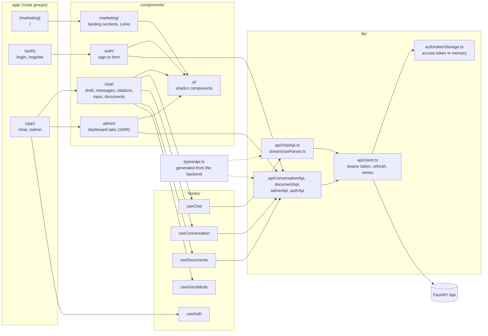
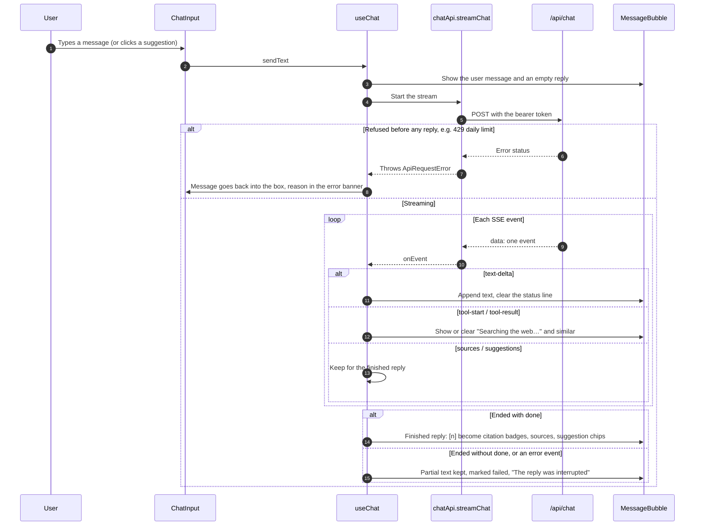

# Chat frontend

The Next.js app, in [`Chatbot/`](Chatbot/). It's built as a static export and served by
the FastAPI backend, so in production it calls the API on the same origin.

## Setup

Requires Node.js 24 and pnpm, and the backend running on port 8000.

```bash
cd frontend/Chatbot
pnpm install
pnpm dev               # http://localhost:3000
```

The backend's `CORS_ORIGINS` must include `http://localhost:3000` for local development.

| Script | What it does |
|---|---|
| `pnpm dev` | Development server |
| `pnpm build` | Static export into `out/` |
| `pnpm lint` | ESLint |
| `pnpm run build:deploy` | Builds for production and copies the result to `backend/app/frontend_build`. `deploy.sh` runs this |
| `pnpm run generate:api-types` | Regenerates `types/api.ts` from the backend's OpenAPI schema. Needs `backend/app/.env` |

### Settings

`NEXT_PUBLIC_API_URL` is the backend's origin. It defaults to `http://localhost:8000`, and
the production build sets it to empty so requests go to the same origin.

## Routes

| Route | Page |
|---|---|
| `/` | Landing page |
| `/login`, `/register` | Sign in and sign up |
| `/chat` | Chat, conversations and documents. Requires sign-in |
| `/admin` | Admin dashboard. Requires admin permissions; admins land here after sign-in |

Pages are protected in the browser by `hooks/useAuth.ts`; the backend checks every
request as well.

## How the pieces connect



## A chat reply in the browser

`useChat` sends the message and builds the reply from the stream's typed events (see the
event table in the backend README):



`streamChat` keeps reading after `done`, because the server saves the turn after sending
it and skips saving if the client has already disconnected.

## How it works

- **Auth:** the access token is kept in memory only (`lib/auth/tokenStorage.ts`). On
  load and before it expires, `lib/api/client.ts` gets a new one from `/api/auth/refresh`
  using the HTTP-only refresh cookie.
- **Conversations:** `useConversation` restores the last active conversation, or the
  newest one. A new account gets a first conversation created automatically.
- **Stored replies:** messages come back with `parts`; `useChat` rebuilds each reply's
  text, sources, web sources and suggestions from them, so citations survive a reload.
- **Citations:** `components/chat/Citation.tsx` turns `[n]` in a reply into a badge
  (never inside code) with a hover card (shadcn `hover-card`) showing the passage or
  page. Only `http` and `https` links are rendered.
- **Suggestions:** shown as buttons under the latest reply only; clicking one sends it.
- **Auto-scroll:** `useAutoScroll` keeps the message list at the bottom while you're
  there, including when an error banner shrinks it, and leaves you alone if you scroll
  up to read.
- **Voice mode:** `useVoiceMode` speaks replies and listens in Chrome. The "Would you
  like to work in voice mode?" question only plays after you've interacted with the page
  (browsers block speech before that), and speech that never starts is dropped after 3
  seconds.
- **Admin data** is fetched with SWR in `components/admin/`. The Usage tab
  (`UsageTab.tsx`) shows token KPIs, breakdowns by purpose and model, and top users from
  `/api/admin/usage`.
- **Titles:** a new conversation's first reply carries a `title` event; `useChat` passes it
  to `useConversation.renameConversation`, so the header and sidebar update live.
- **No images from replies:** `MessageBubble` renders Markdown images as their alt text,
  so an injected image can't send data to another site.
- **Demo video:** the landing page's `#demo` section (`components/marketing/DemoVideo.tsx`)
  loops `public/demo/chat-demo.mp4`, rendered from `demo-video/`. It plays only while on
  screen, has a pause button, and doesn't autoplay with reduced motion. Change its speed
  with `DEMO_PLAYBACK_RATE` at the top of that file (1 is as rendered).
- **Design:** one palette for the whole app in `app/globals.css` (`:root` for light,
  `.dark` for dark, dark by default via `next-themes`): zinc neutrals and one emerald
  (`--live`) reserved for live states. Chat uses shadcn `Button` and `Sheet` (the
  conversation list on phones, documents at every width). The landing page scrolls with
  Lenis (`components/marketing/SmoothScroll.tsx`), which respects reduced motion and
  pauses while a sheet is open. The full system is in `Chatbot/DESIGN.md` when present
  locally.

## Structure

```
Chatbot/
  app/
    (marketing)/     Landing page
    (auth)/          Sign in and sign up, sharing one layout
    (app)/           Chat and admin
    globals.css      Theme tokens for the whole app
  components/
    marketing/       Landing page sections, SmoothScroll (Lenis), footer
    auth/            Sign-in form
    chat/            ChatShell, MessageList, MessageBubble, Citation, ChatInput,
                     ConversationList, DocumentPanel
    admin/           Dashboard tabs and cards
    ui/              shadcn/ui components
  hooks/             useAuth, useChat, useConversation, useDocuments, useVoiceMode,
                     useAutoScroll
  lib/               API clients, token storage, SSE parser, voice helpers
  types/api.ts       Generated from the backend; don't edit by hand
```
